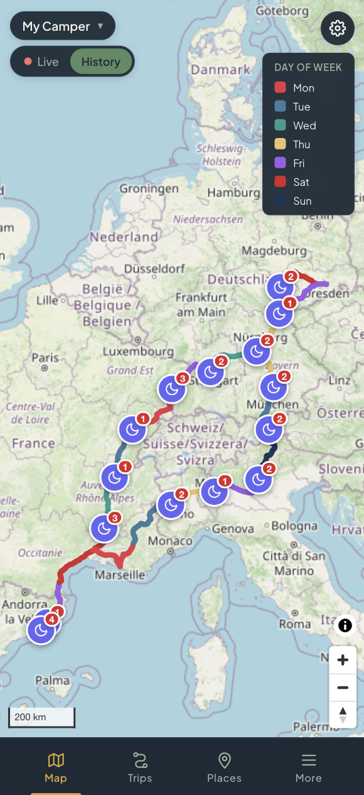
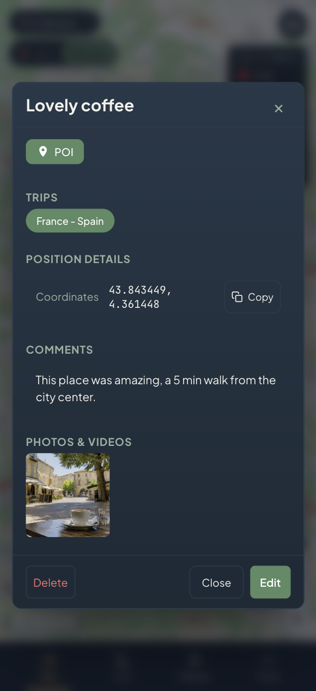

<div align="center">


# Buteo

### Know where it is. Remember where it's been.

[](LICENSE)

</div>

---

Buteo is a **privacy-first, self-hosted travel log and live location companion**. It effortlessly transforms your raw GPS tracking data into beautifully organized trips, overnight stays, custom places, and rich media-filled travel memories.

Built specifically for adventurers, road-trippers, and vanlifers—not fleet managers. Buteo is designed to help you **remember the journey**, not just monitor assets.

---

## ✨ Key Highlights

- 🗺️ **Stunning Live Map**: See your vehicle or device's current position instantly on a responsive, high-performance map interface.
- � **One-Click Trip Generation**: Seamlessly process raw GPS coordinate streams into elegant, road-snapped travel tracks.
- 🏕️ **Automatic Overnight Spot Detection**: Smart algorithms automatically detect, bundle, and merge overnight stays with precise multi-night counters.
- 📍 **Personal Points of Interest (POIs)**: Bookmark your favorite campsites, water sources, viewpoints, and hidden gems with custom categories and rich descriptions.
- 📸 **Visual Travel Journal**: Attach photos, videos, and journal notes directly to your trips, overnight spots, and custom places.
- 📱 **Bring Your Own Device (BYOD)**: Native support for robust hardware GPS trackers (e.g., Teltonika) or free smartphone tracking apps (Traccar Client, OwnTracks).
- 🔒 **Privacy Redacted Sharing**: Create beautiful public share links with customizable real-time delay offsets and location blurring corridors to keep your exact current whereabouts private.
- 🐳 **Self-Hosted Simplicity**: Packaged beautifully with Docker Compose. Zero telemetry, zero subscriptions, and complete ownership of your location history.

---

## Why Buteo?

### Built for travelers, not truck fleets.

Most GPS tracking applications are cold, clinical, corporate fleet dashboards designed to spy on delivery drivers. They are bloated, expensive, and require locked-down proprietary hardware that bills you high monthly subscription fees.

**Buteo is a breath of fresh air.**

- **Complete Hardware Freedom:** Use highly durable, industry-standard professional vehicle trackers (like the Teltonika FMC920, available for ~40-60€) or just convert an old smartphone using open-source utilities. No vendor lock-in, ever.
- **Warm & Nostalgic Design:** A clean, adventure-focused design language that feels like an elegant physical travel journal rather than an asset tracking tool.
- **Uncompromising Location Privacy:** Your exact coordinate data remains strictly on your own hardware. Your home base, wild camping spots, and daily patterns are safe from corporate data brokers.
- **Intelligent Automation:** No clunky manual logs or over-promised buggy AI. Buteo combines raw GPS intelligence with clean user control, giving you perfect maps with zero effort.

---

## 🚀 Quick Start (Up in 5 Minutes)

### 1. Clone Buteo
```bash
git clone https://github.com/buteo-io/Buteo.git
cd Buteo
```

### 2. Configure Environment
Copy the example configuration to kickstart your environment:
```bash
cp .env.example .env
```
Choose your `DATABASE_TYPE` and `DATA_DIR` in the `.env` file.
*(Optionally tweak the `.env` file to customize your secret tokens and database paths).*

### 3. Launch the Stack
```bash
docker compose up -d --build
```
Your Buteo instance is now running! Navigate to **http://localhost:5124** in your web browser or the domain you've linked it to with your reverse-proxy.

### 4. Provision Your Account
Create your first user account via the CLI manager:
```bash
docker compose run --rm api python -m tracker_core.cli.manage create-user \
  --email you@example.com --password "your-secure-password"
```

### 5. Register Your Tracker
Add your tracking device to your account:
```bash
docker compose run --rm api python -m tracker_core.cli.manage create-device \
  --email you@example.com --imei 123456789012345 --name "Our Camper"
```

---

## 📸 App Walkthrough

<div align="center">
  <p align="center">
    <b>Interactive Trip Overview</b><br>
    <i>Explore exact driving tracks, altitude profiles, speed analytics, and automatic overnight detection in one responsive interface.</i>
  </p>
  
  
  <br><br>
  
  <p align="center">
    <b>Rich Places & Travel Journal Memories</b><br>
    <i>Save favorite wild camping spots, viewpoints, or resources and link them with photos, media files, and rich travel log notes.</i>
  </p>
  
</div>

---

## 🗺️ Roadmap

We are active travelers and engineers building Buteo in the open. 

- [x] Responsive PWA (Progressive Web App) support for seamless mobile mapping
- [x] Multi-night overnight clustering and database cascades
- [x] GPX, KML, and GeoJSON trip exports
- [ ] **Buteo Cloud** (fully-managed hosted offering for zero-ops users)
- [ ] Offline-first maps for remote backcountry exploration
- [ ] Multi-day storytelling logs automatically combining photos and telemetry
- [ ] Native iOS & Android companion applications

[Explore our full interactive roadmap →](https://github.com/orgs/buteo-io/projects)

---

## 🤝 Contributing & Community

Whether you're a developer, designer, copywriter, or outdoor enthusiast, we'd love your help making Buteo the best travel log in the world!

### Local Development Flow
```bash
# Run local developer stack
docker compose up -d --build

# Run tests
pytest apps/api/api/tests/

# Lint
ruff check apps/api apps/ingest packages/core
```

### Join Us
* 🐛 **Found a bug?** Open a GitHub Issue.
* 💡 **Have a feature idea?** Jump into GitHub Discussions.
* 🔧 **Want to code?** Check out [CONTRIBUTING.md](CONTRIBUTING.md) and submit a Pull Request!

---

## 📄 License

Buteo is licensed under the **GNU Affero General Public License v3 (AGPL-3.0)**. Check out [LICENSE](LICENSE) for details.

- Self-host completely free for personal use.
- Commercial licensing and custom configurations are available upon request.
- *Buteo is provided with absolutely no warranty. Adventure safely and responsibly.*

---

## 🔗 Project Resources

- 🌐 **Official Website**: [https://getbuteo.com](https://getbuteo.com) *(coming soon)*
- 📖 **Technical Architecture**: [docs/README.md](docs/README.md)

---

<div align="center">

**Built with ❤️ by vanlife travelers, for adventurers everywhere.**

</div>
