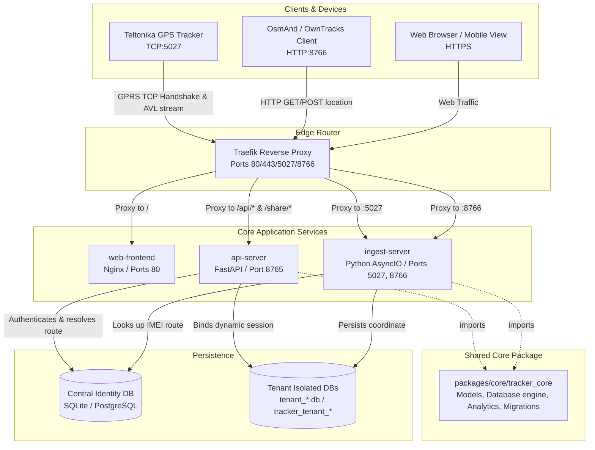
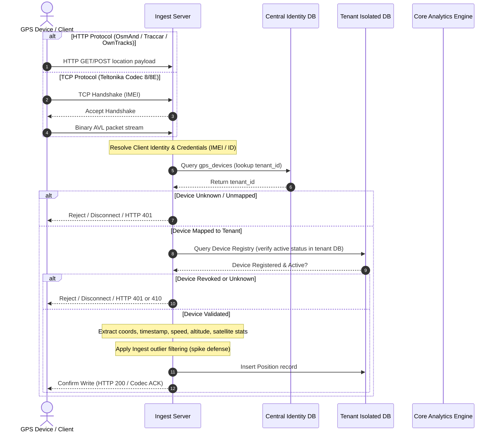
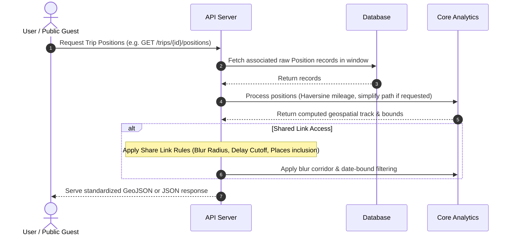

# TrackMy System Architecture

This document details the system design, component boundaries, data flow pipelines, and database relations for the TrackMy platform.

---

## 1. System Topology & Component Overview

TrackMy is a modular open-core platform separated into three principal services (`apps/api`, `apps/ingest`, `apps/web`) and a shared domain package (`packages/core/tracker_core`).



---

## 2. Shared Core Package (`packages/core/tracker_core`)

The monorepo centers around `tracker_core` to prevent duplication of logic across independent deployment units (API and Ingest).

- **`store/`**: SQLAlchemy ORM declarations (`models.py`) and transactional connection engines (`db.py`). 
- **`internal/appctx/`**: Pydantic-Settings declaration (`config.py`) parsing and validating environment configuration.
- **`analytics.py`**: Pure utility library for geographic and trip calculations (Haversine distances, path smoothing, spatial aggregation, trip isolation, export builders).
- **`overnight_service.py`**: Business-domain orchestrator for incremental overnight spot detection and merging logic.
- **`queries.py`**: Centralized, performance-optimized database queries with window constraints and safety caps.
- **`alembic/`**: Active database schema and step-by-step SQL migration paths.

---

## 3. Data Pipelines & Flows

### A. Location Ingest Data Flow

TrackMy supports high-frequency TCP stream tracking alongside intermittent HTTP pushing. Regardless of source protocol, data undergoes consistent filtering and parsing prior to persistence.



### B. Map Visualization and Share API Flow



---

## 4. Database Schema (Entity Relationship Diagram)

TrackMy handles multiple trackers across different real-world entities (e.g., vehicles, individuals, pets). Below is the logical data model schema.

```mermaid
erDiagram
    User ||--o{ Device : "manages"
    User ||--o{ Place : "defines"
    User ||--o{ Tag : "owns"
    User ||--o{ ShareLink : "configures"
    User ||--o{ OvernightSpot : "owns"

    Entity ||--o{ Device : "binds to"
    Device ||--o{ Position : "records"
    Device ||--o{ Trip : "groups positions into"
    
    Trip ||--o{ OvernightSpot : "contains"
    
    Place ||--o{ PlaceMedia : "attaches"
    OvernightSpot ||--o{ OvernightSpotMedia : "attaches"
    
    %% Junction tables
    Place }|--|{ Trip : "place_trips (M:M)"
    ShareLink }|--|{ Place : "share_link_places (M:M)"
    ShareLink }|--|{ OvernightSpot : "share_link_overnight_spots (M:M)"

    User {
        int id PK
        uuid public_id UK
        string email UNIQUE
        string password_hash
        int token_version
        datetime created_at
    }

    Entity {
        int id PK
        uuid public_id UK
        string name
        string entity_type "vehicle | pet | person | tracker"
        datetime created_at
    }

    Device {
        int id PK
        uuid public_id UK
        string imei UNIQUE
        string name
        int user_id FK
        int entity_id FK
        datetime last_seen_at
        datetime revoked_at
    }

    Position {
        int id PK
        int device_id FK
        datetime time_id
        double lat
        double lon
        double speed
        double altitude
        int satellites
    }

    Trip {
        int id PK
        uuid public_id UK
        int device_id FK
        string name
        datetime started_at
        datetime ended_at "NULL if ongoing"
        datetime overnights_last_checked_position_time
    }

    Place {
        int id PK
        uuid public_id UK
        int user_id FK
        double lat
        double lon
        string name
        string notes
        int place_type_id FK
    }

    PlaceMedia {
        int id PK
        uuid public_id UK
        int place_id FK
        int user_id FK
        string filename_stored
        string media_type
        datetime created_at
    }

    Tag {
        int id PK
        int user_id FK
        string name
    }

    ShareLink {
        int id PK
        uuid public_id UK
        int user_id FK
        int trip_id FK
        string token "SHA-256 hashed"
        int delay_hours
        double blur_meters
        datetime expires_at
    }

    OvernightSpot {
        int id PK
        uuid public_id UK
        int user_id FK
        int trip_id FK
        double lat
        double lon
        int nights_count
        datetime last_stay_at
    }
```
